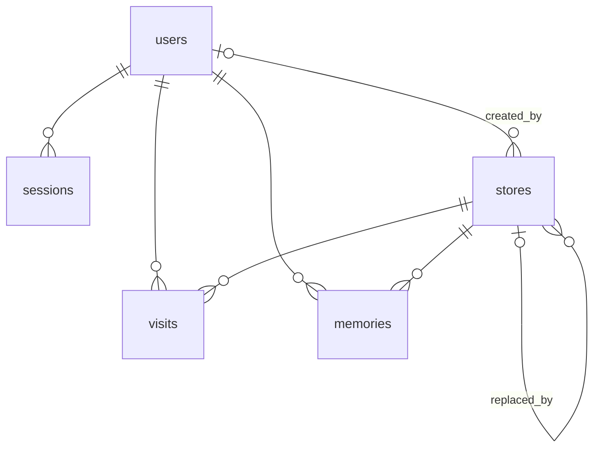

# 資料模型

日期：2026-10-25　階段：6. 最小設計

名詞見 [GLOSSARY.md](../../GLOSSARY.md)，規則來源見 [MVP 詳細使用情境](../user_stories/mvp-user-scenarios-detail.md)。第 7 階段照本文件寫第一個 migration，之後以 migration 檔為準。



## 資料表

ID 一律 `uuid`（`gen_random_uuid()`），不讓人從 ID 推測資料量。時間一律 `timestamptz`（UTC）。所有表開 RLS、不寫政策。

### users

| 欄位 | 型別 | 規則 |
| --- | --- | --- |
| id | uuid | 主鍵 |
| email | text | 存小寫，唯一 |
| password_hash | bytea | scrypt 結果 |
| salt | bytea | 每人隨機 |
| created_at | timestamptz | |

### sessions

| 欄位 | 型別 | 規則 |
| --- | --- | --- |
| token_hash | bytea | 主鍵，token 的 SHA-256 |
| user_id | uuid | → users，刪除使用者時一起刪 |
| expires_at | timestamptz | 每次使用往後延一個月 |

### login_failures

不存在的 email 也要計數，所以獨立一張，不放在 users。

| 欄位 | 型別 | 規則 |
| --- | --- | --- |
| email | text | 主鍵，存小寫 |
| fail_count | int | 登入成功時刪除該列 |
| locked_until | timestamptz | 可空；達 10 次時設為 15 分鐘後並歸零計數 |

### stores（店家）

| 欄位 | 型別 | 規則 |
| --- | --- | --- |
| id | uuid | 主鍵 |
| name | text | 必填 |
| location | geography(Point, 4326) | 大概位置，必填 |
| google_url | text | 可空；展開後的完整網址，展開失敗則為短網址 |
| google_code | text | 可空；`0x…:0x…`，只作查重提示 |
| created_by | uuid | 可空；→ users，刪除使用者時設為空 |
| verified_at | timestamptz | 有值＝已核對 |
| replaced_by | uuid | 有值＝已被取代；→ stores，永遠指向未被取代的店家 |
| created_at | timestamptz | |

- 店家不會被真的刪除，只會被取代。
- 索引：`location` GiST（2 公里內查重、距離排序）、`name` GIN trigram（店名搜尋與相似度）、`google_code`。

### visits（到訪）

| 欄位 | 型別 | 規則 |
| --- | --- | --- |
| id | uuid | 主鍵 |
| user_id | uuid | → users，刪除使用者時一起刪 |
| store_id | uuid | → stores，禁止刪除（`on delete restrict`） |
| rating | smallint | 必填，1～3：3 我會推薦人來、2 我會再來、1 可以再給次機會 |
| note | text | 可空，20 字以內 |
| kinds | text[] | 可空；只能是 `restaurant`、`snack`、`cafe`、`dessert`、`bar`、`other` |
| price | smallint | 可空，1～5，對應 `$`～`$$$$$` |
| pet | smallint | 可空，1～3：3 可帶、2 有條件可帶、1 不可帶 |
| payments | text[] | 可空；只能是 `cash`、`card`、`mobile`、`other` |
| created_at | timestamptz | 後端寫入，不收前端值 |

- 選項用 `smallint`／`text[]` 加 check constraint，不用 Postgres enum（之後難刪改選項）。
- 不能修改，只能新增與刪除。
- 索引：`(user_id, store_id)`、`(store_id)`。

### memories（回憶）

| 欄位 | 型別 | 規則 |
| --- | --- | --- |
| user_id | uuid | 主鍵之一；→ users，刪除使用者時一起刪 |
| store_id | uuid | 主鍵之一；→ stores，禁止刪除 |
| created_at | timestamptz | 成為回憶的時間 |

## 推算而不存的值

以下都從 visits 即時推算，不另外存：

- **私房店**：該使用者在該店家有到訪。
- **來訪天數**：`count(distinct (created_at at time zone 'Asia/Taipei')::date)`。
- **最新評價、補充資訊每項最近有填的值、預覽卡價位、清單排序**：依 `created_at` 取最近一筆（補充資訊取最近一筆非空值）。
- **亮度**：view `store_brightness`：

```sql
-- ponytail: 每次查詢即時算，試用規模（幾百筆到訪）夠用；變慢再改 materialized view 或快取欄位。
create view store_brightness as
select store_id,
       count(*) + 2 * count(*) filter (where days >= 2) as score
from (
  select store_id, user_id,
         count(distinct (created_at at time zone 'Asia/Taipei')::date) as days
  from visits
  group by store_id, user_id
) per_user
group by store_id;
```

等級（1–2／3–5／6+）在後端換算，不放進 view，門檻好調整。

## 核對（情境 06）在資料上的動作

同一個交易內：

1. 新增一筆 stores，`verified_at = now()`。
2. 舊店家與「`replaced_by` 指向舊店家」的店家，`replaced_by` 都改為新店家（只需轉一次）。
3. visits 的 `store_id` 從舊店家改為新店家。
4. memories：每位使用者在舊店家中只要有一家沒有回憶，就刪掉他在這些店的回憶；全部都是回憶則合併成一筆，`created_at` 取最晚。
