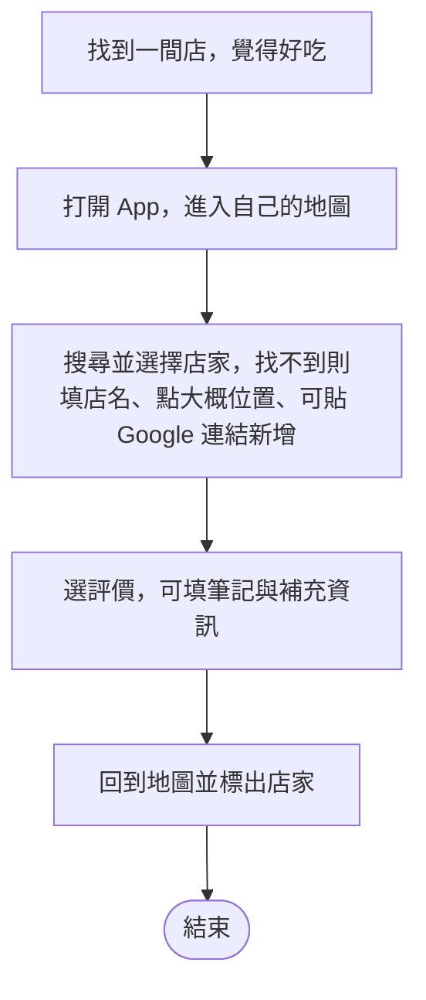
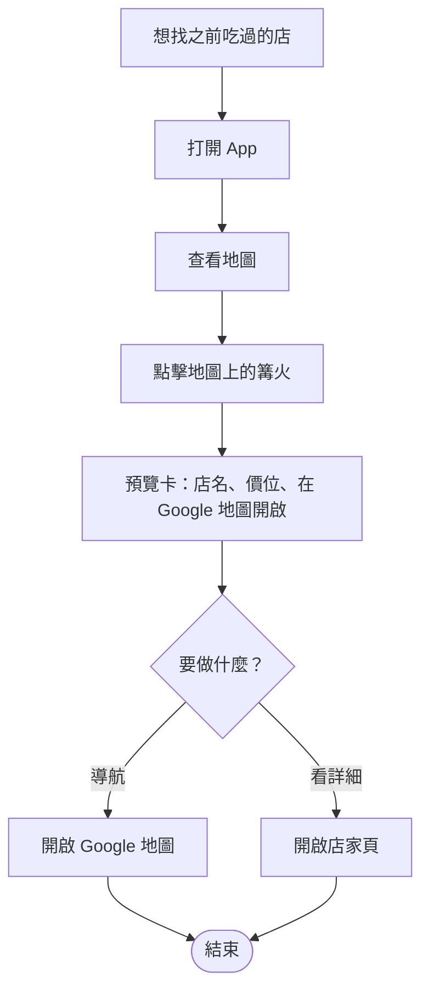
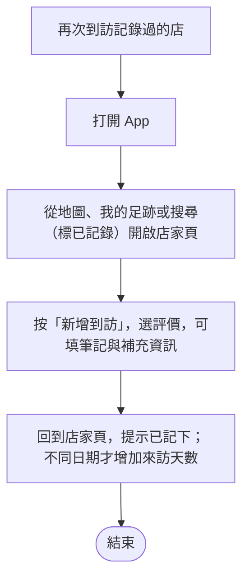
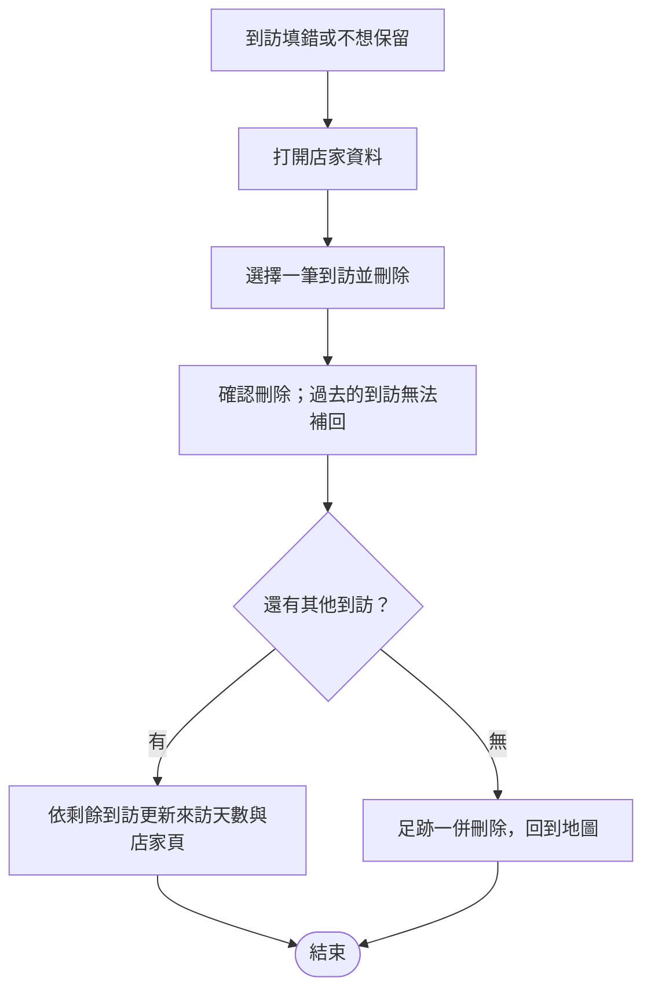
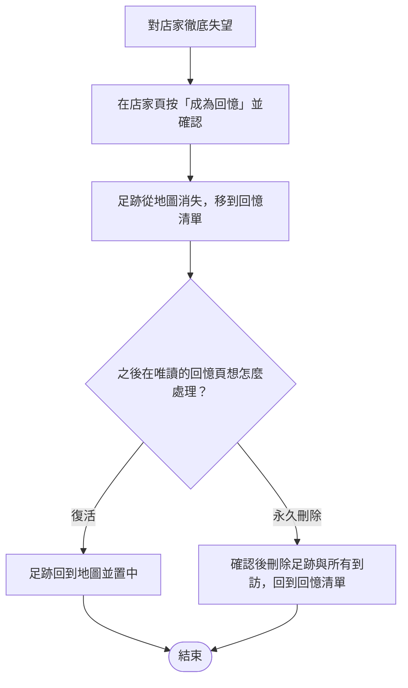

# MVP 使用者情境草案

先記錄主要使用流程，詳細操作與例外情境見 [MVP 詳細使用情境](mvp-user-scenarios-detail.md)，名詞定義見 [GLOSSARY.md](../../GLOSSARY.md)。

第一個 MVP 的預期：一定要登入；不提供好友功能，也不能查看其他使用者的足跡；使用者只查看自己的足跡與地圖。選店時可搜尋所有人建立的店家基本資料，但不顯示他人的足跡。

## MVP 範圍檢視

- 情境 1、2 為核心：留下自己的足跡，並能在自己的地圖找回店家。
- 情境 3 為回訪：到訪記錄不設限，來訪天數以不同日期計算。
- 情境 4、5 為個人足跡的維護：沒有修改功能，更正只能刪除重寫；刪除足跡不刪除共用店家。
- 系統方不定期核對店名與地址、更新店家資料並標示「已核對」，屬管理作業，與一般使用者流程分開；專用查核介面是否列入第一版仍待確認。
- 「已核對」僅代表店家身分與大概位置已核對，不代表評價、實際到訪或補充資訊已核對。
- 移出 MVP：離店後補登（到訪日期固定為記錄當下）、修改紀錄、照片、訪客模式、第三方登入。好友、他人足跡、公開探索與美食家功能不納入。

## 1. 記錄好吃的店

## 2. 找回之前吃過的店

## 3. 再次到訪記錄過的店

## 4. 刪除到訪

## 5. 成為回憶、復活與永久刪除

